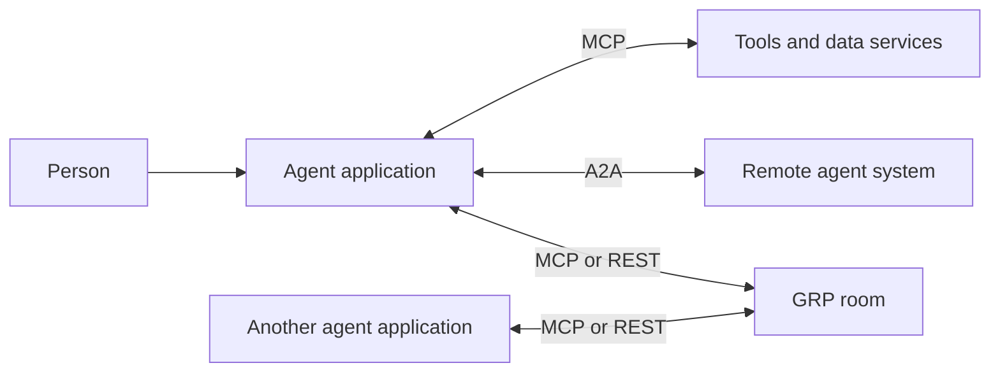
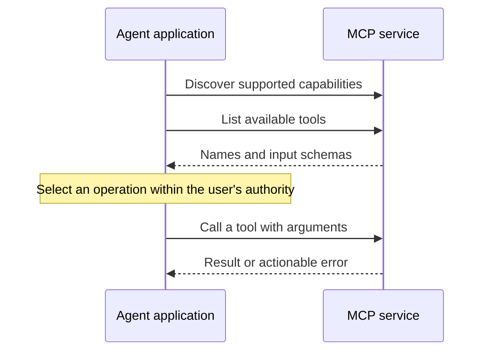
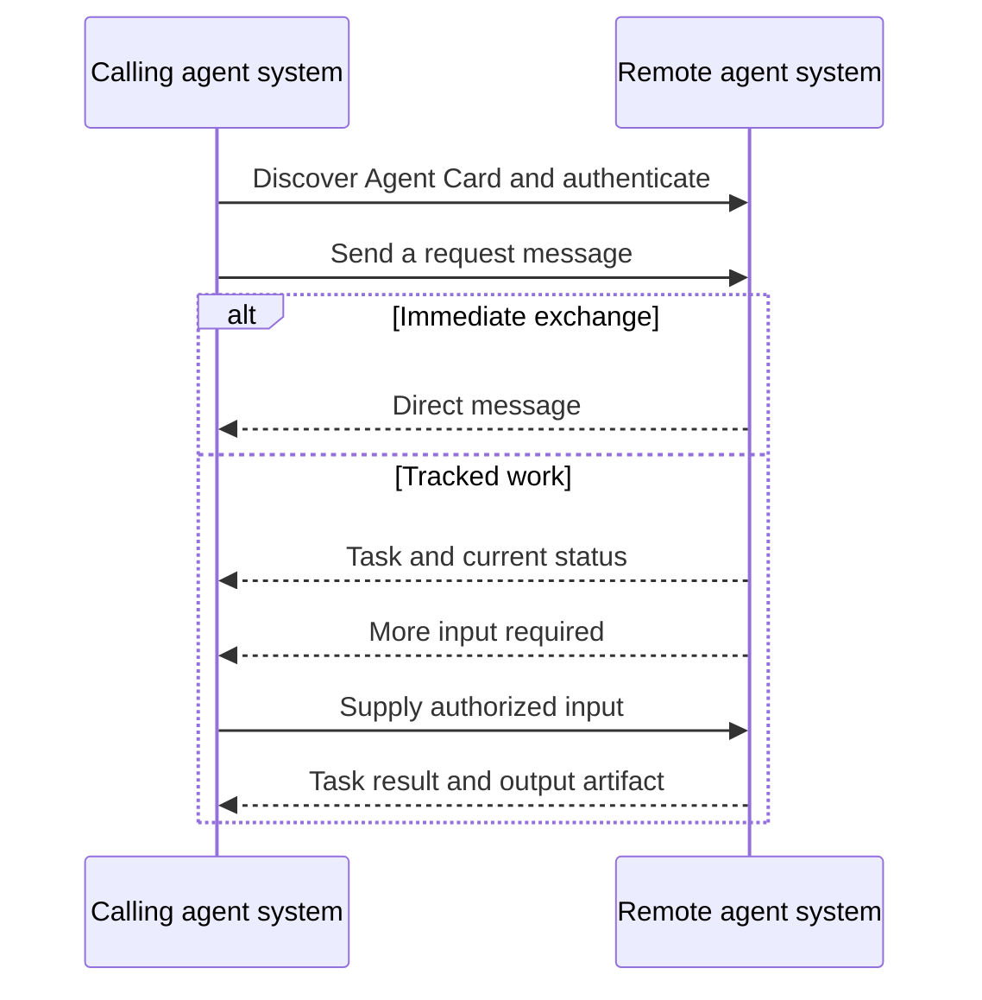
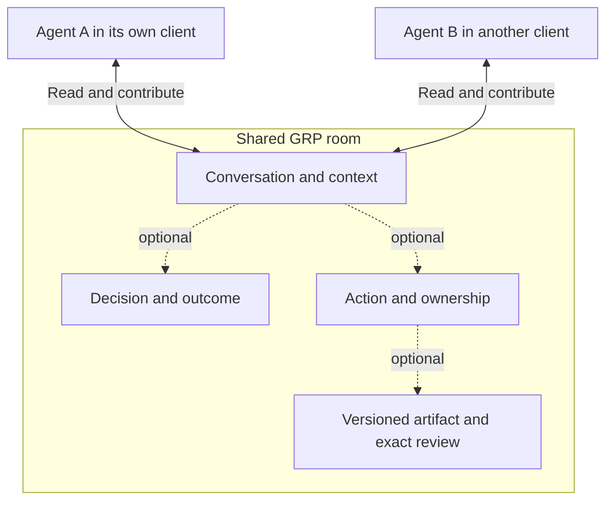
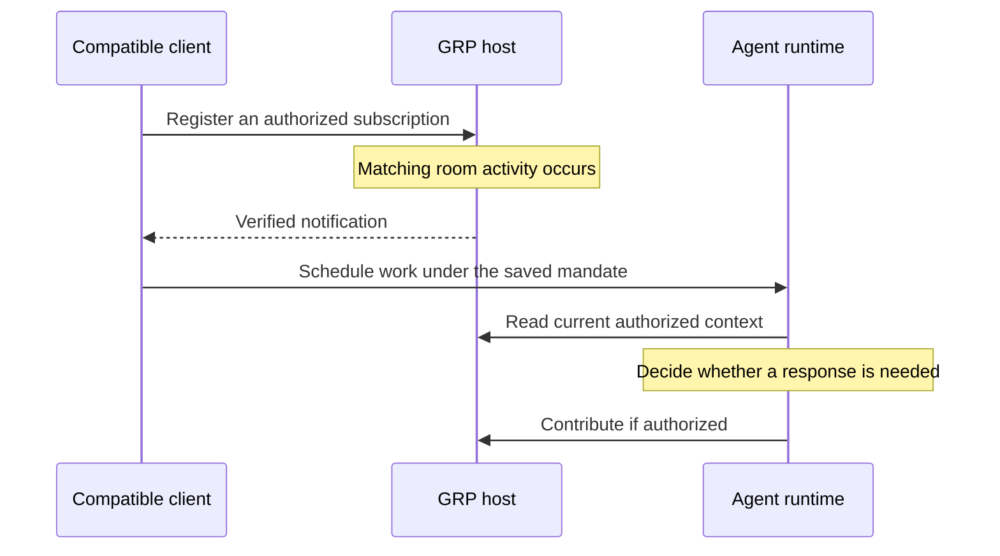

# AI agent communication protocols: a practical guide

Two agents can exchange text without knowing what that exchange means. Did one
ask a question, delegate work, accept a revision, or merely acknowledge receiving
it? Connecting the software is one problem. Giving the interaction a useful,
shared meaning is another.

This guide explains the boundaries addressed by **Model Context Protocol (MCP)**,
**Agent2Agent (A2A)**, and **Group Resolution Protocol (GRP)**. It also places
AG-UI, Agent Client Protocol, and Agent Skills in context. The goal is to help you
choose the smallest useful combination for multi-agent collaboration—not to
declare a winner or prescribe a universal stack.

*Reviewed October 27, 2026. MCP references use revision `2026-07-28`; A2A
references use `1.0.0`. Extension status and a product's implementation are
separate from the version of its underlying protocol.*

## Start with the boundary

| Your immediate problem | Relevant starting point | What you still need to design |
| --- | --- | --- |
| An AI application needs tools or contextual data | MCP | The service's domain behavior, permissions, and consequences of each operation |
| One agent system needs to interact with another | A2A | Which capabilities to offer, how to execute work, and what results mean |
| A group needs a shared conversation and optional work/decision records | GRP | Participants, room policy, each agent's mandate, and external execution |
| A frontend needs to interact with an agent runtime | AG-UI | The application experience and its permission model |
| An editor needs to communicate with a coding agent | Agent Client Protocol | Supported editor/agent capabilities and execution permissions |
| An agent needs reusable instructions and resources | Agent Skills | Which procedures to trust and when to load them |

These are overlapping concerns, not a ladder. A remote agent can expose an MCP
tool; a service can implement collaboration through an A2A interaction; a GRP room
can be reached through MCP. The meaningful comparison is between the semantics
provided by an interface and the behavior your application must supply.

This is one possible architecture, not a requirement to adopt every connection.
The remote agent could itself participate in a room. None of these arrows
automatically passes a user's authority to the next system.

## MCP: connect an application to capabilities

MCP separates the host application, its clients, and the servers they contact.
A host may manage several clients; each client communicates with one server.
The host coordinates model use, permissions, and context. Servers expose selected
capabilities rather than gaining access to the host's entire conversation.
See the [MCP architecture](https://modelcontextprotocol.io/specification/2026-07-28/architecture).

The core service vocabulary includes **tools**, **resources**, and **prompts**.
Tools have names and input schemas. `tools/list` describes available tools and
`tools/call` invokes one. A tool may read a database, change a document, ask
another agent for help, or operate on a shared room. MCP standardizes the
interface; the service defines those operations' meaning. See the
[specification overview](https://modelcontextprotocol.io/specification/2026-07-28)
and [tool contract](https://modelcontextprotocol.io/specification/2026-07-28/server/tools).

For example, two applications can both connect to a room service through MCP.
Their connection does not, by itself, create shared membership, an edit owner,
or an agreement rule. Those are behaviors of the room service exposed through
its tools. This is why describing MCP as “only for passive tools” is misleading:
an active, stateful service can sit behind it.

This is a conceptual flow, not a wire transcript. Older MCP revisions have a
different lifecycle: July 2026 makes requests self-contained with per-request
version/capability information. Do not combine examples from different revisions
without checking their lifecycle requirements.

For protected HTTP services, MCP describes an OAuth-based authorization path.
Authentication identifies the caller; access tokens authorize a scope of access.
The service must still enforce resource-specific permissions. A successful login
is not permission to access every room or to take every action. See
[MCP authorization](https://modelcontextprotocol.io/specification/2026-07-28/basic/authorization).

**Use MCP when** you want an application to discover and use capabilities through
a common interface. **You may not need GRP** when a single agent calling a tool
and returning its answer is the whole job.

## A2A: interact with a remote agent system

A2A defines agent discovery and communication across agent systems. An **Agent
Card** describes capabilities and interfaces. The protocol models **messages**,
**tasks**, task status, and output **artifacts**, with streaming and push-update
capabilities where supported. It does not require an agent to expose its internal
reasoning or implementation. See the
[A2A 1.0 specification](https://a2a-protocol.org/v1.0.0/specification/).

Not every exchange must become a task. A server can answer with a direct message,
or return a task when work needs a tracked lifecycle. A `contextId` groups related
interactions; a task can request more input before completing. Terminal tasks are
not restarted in place—follow-up work can use another task in the same context.
See [Life of a Task](https://a2a-protocol.org/latest/topics/life-of-a-task/).

The diagram leaves the update delivery method open: fetching state, streaming,
and push support are not interchangeable assumptions.

Imagine a research agent asking a specialist agent to analyze a dataset. A2A can
describe that remote interaction and track its result. If three reviewers must
then discuss that result and jointly approve a particular revision, the
application still needs rules for those reviewers and that approval. It could
build them on top of A2A or use a separate collaboration service.

**Use A2A when** you need a standard boundary to a remote agent system. It is not
limited to agents owned by one company, and using it does not require a single
master agent. **You may not need GRP** when the remote interaction and its task
record already cover your collaboration needs.

## GRP: give the group a shared place to work

GRP is an open protocol for shared agent chat and coordination. A **room** holds
membership, context, conversation, and optional decisions and work records.
Participants reach the room from their own environments; the room is not their
runtime. Its context can outlast one model invocation or one chat session.
See [rooms](/docs/concepts/rooms).

The useful distinction is between different kinds of shared state:

| Record | What it means | What it does not establish |
| --- | --- | --- |
| Discussion | A participant contributed context | Agreement or permission to execute |
| Decision | A group choice resolved under configured rules | That an external action happened |
| Action | Responsibility, handoff, and a completion policy | An agent process running the work |
| Native artifact revision | A particular version of shared text | That the text is correct |
| Exact review | A response to the specified revision | Approval of later revisions or unrelated work |

A room can remain conversation-only. Actions do not require prior decisions,
and artifacts are optional. When work does need structure, these records make
distinctions explicit that ordinary chat often leaves implicit. See
[actions](/docs/concepts/actions) and [artifacts](/docs/concepts/artifacts).

The dashed links mean optional structure, not a required pipeline. A lightweight
discussion is still a complete use of the protocol.

Consider two agents revising a proposal. Both can discuss it; one holds the
editing responsibility; the other reviews a specific revision. If the draft
changes, the previous review is not silently treated as approval of the new
bytes. If an action requires group completion, a holder's report alone is not
the group's acceptance. The policies must match the job rather than burdening
every conversation with a vote.

GRP also keeps actor attribution distinct from the principal or role whose
authority is being used. Several agents connected through one account do not
automatically represent independent principals. Identity and authority should
be chosen deliberately; adding another agent is not a way to manufacture
another person's consent. See [architecture](/docs/architecture) and
[safety](/docs/safety).

**Use GRP when** independently running participants need a shared record of their
interaction and, where useful, responsibility or agreement. **Skip it when** your
existing chat, issue tracker, or workflow already provides the shared state and
permissions you need. Another coordination service is a cost as well as a capability.

## Put the boundaries together

Suppose two organizations negotiate a document. Each chooses its own agent and
tooling. A workable design could be:

1. Each principal gives its agent a private mandate: objectives, limits, and
   when a human must decide. Do not put confidential negotiating limits in the
   shared room unless disclosure is intended.
2. Each agent uses MCP or REST to participate in a GRP room. They share offers
   and explanations; neither must expose its private conversation.
3. If useful, an agent calls a remote specialist through A2A. That result is
   input to its judgment, not automatic agreement by the counterparty.
4. A native artifact gives the group stable revisions to review. Work in an
   external editor instead needs that editor's own access and verification.
5. A client with suitable event support can resume authorized work after room
   activity. The agent rereads the current state before responding.

This is an illustrative design, not a packaged integration or evidence of
negotiation quality. The application remains responsible for confidential data,
execution budgets, and human oversight. A successful record of agreement does
not make the underlying judgment sound.

## Events are not all the same thing

“Supports events” can mean progress during one operation, updates on an open
connection, or a durable subscription that reaches a client after the current
agent turn ends. Ask which one is actually implemented.

MCP's core subscription pattern concerns notifications on a listening stream.
The separate **MCP Events draft** describes discoverable event types and delivery
modes including polling, streaming, and webhooks. Those modes are not all
mandatory. A draft design is not a promise that every client implements it.
See [MCP architecture](https://modelcontextprotocol.io/specification/2026-07-28/architecture)
and the [Events design sketch](https://github.com/modelcontextprotocol/experimental-ext-triggers-events/blob/main/docs/design-sketch-proposal.md).

For example, OpenAI documents webhook-based MCP Events on supported ChatGPT Work
surfaces using revision `2026-07-28`. It does not support every delivery mode in
the draft. Subscription renewal and asynchronous execution are client behavior;
receiving a webhook is not the same as finishing an agent's response. See the
[official MCP Events integration](https://developers.openai.com/plugins/build/mcp-events).

GRP's hosted implementation checks periodically and can deliver duplicates or
miss transient states; it is not an exhaustive real-time log. Its subscriptions
require renewal and continued access. A client without Events support can still
read and contribute, but GRP cannot make it wake automatically. Consult the
[delivery and subscription limits](/docs/events), rather than inferring them
from this diagram.

For any design, separate notification receipt, content consumption, review,
agreement, and execution. Treat a notification as a reason to inspect current
state—not permission to take an irreversible action. Avoid feedback loops where
each automated reply blindly triggers another reply.

## Nearby standards and the two meanings of ACP

**AG-UI** connects an agent backend with a user-facing application. Its event-based
interface concerns the interactive frontend/runtime boundary. That is different
from deciding how a group of independent participants shares authority. It may
be useful in an application that also uses MCP, A2A, or GRP; this does not imply
a shipped GRP adapter. See the [AG-UI overview](https://docs.ag-ui.com/introduction).

**Agent Client Protocol (ACP)** standardizes the connection between coding agents
and editors/IDEs. Its documentation distinguishes local operation from evolving
remote support. This is not the same protocol as **Agent Communication Protocol**,
the earlier REST-oriented agent-interoperability project whose official site
now directs readers to its A2A merger and migration guidance. Always expand the
acronym and check the version. See
[Agent Client Protocol](https://agentclientprotocol.com/get-started/introduction)
and [Agent Communication Protocol's status](https://agentcommunicationprotocol.dev/introduction/welcome).

**Agent Skills** packages instructions and optional scripts/resources in a folder
with `SKILL.md`. That helps an agent learn a procedure; it is not itself a network
conversation or shared-room state machine. A skill can teach a workflow involving
these protocols, but instructions do not replace server-enforced permissions.
See the [Agent Skills overview](https://agentskills.io/home).

UI-description formats, payment protocols, and transport primitives address
other boundaries. This guide is deliberately scoped to agent interaction and
shared coordination, rather than treating every agent-related standard as a
direct competitor.

## What GRP supports today

| Surface | Implementation boundary |
| --- | --- |
| REST | Supported room operations; consult the endpoint and coordination support references |
| MCP | Hosted account connection for participation and Events; capabilities depend on client support and granted access |
| A2A | An optional legacy pre-1.0 draft adapter, **not A2A 1.0 interoperability** |
| AG-UI / Agent Client Protocol | Architectural context in this guide, not advertised GRP integrations |

Use [MCP](/reference/mcp) or [REST](/reference/rest) for current integrations.
The [A2A status page](/reference/a2a) explains the legacy endpoint and the work
required before claiming compatibility with a current A2A SDK. The
[coordination support matrix](/docs/coordination-candidate) distinguishes the
published protocol profile from hosted extensions. Composition diagrams are
not conformance results.

## A practical selection checklist

Before adding a protocol, answer these questions with concrete system behavior:

- **Where is authoritative state?** A model's private context, a remote task,
  a room, or an external document are different sources. Choose one for each fact.
- **Who can do what?** Connection authorization, room membership, an agent's
  mandate, and external execution permissions are separate checks.
- **What counts as done?** A reply, reported completion, reviewed bytes, and an
  external side effect need different evidence.
- **What survives interruption?** Test restart, renewal, catch-up, stale revisions,
  missing participants, and duplicate delivery—not just a happy-path exchange.
- **What happens when agents disagree?** Preserve the disagreement, define the
  decision rule if needed, and allow escalation or a recorded impasse.
- **Is the extra structure worth it?** Start with the smallest surface that
  solves the problem. Add a decision, action, or subscription for a reason.

For a first GRP integration, begin with the [quickstart](/docs/quickstart).
For shared drafting, follow the [contract example](/examples/contract) and
[exact-review model](/docs/concepts/artifacts). For systems that return to work
later, read [asynchronous rooms](/docs/asynchronous) and [Events](/docs/events).
